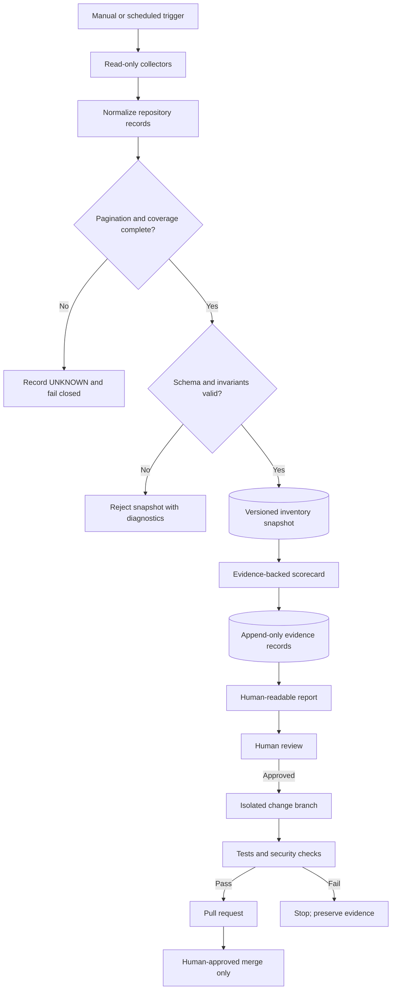
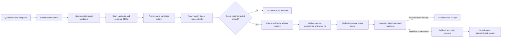

# X4 BEASTMODE — Fleet Engineering Standard

**Status:** proposal for review. This document defines contracts and intended controls; it does not assert that a release or deployment has run.

## Goals

- Evidence-first fleet inventory, scorecards, and change proposals.
- Local validation by default; read-only remote inspection unless an explicitly reviewed workflow grants a narrowly scoped permission.
- Immutable release identity from source commit through artifact and runtime observation.
- Fail-closed behavior when provenance, coverage, schema, or health evidence is missing.
- Human review before merge or production changes.

## Operating modes

| Mode | Permitted behavior | Prohibited behavior |
|---|---|---|
| Observe | Read metadata, validate files, calculate metrics, emit reports | Writes to GitHub, remote hosts, or production |
| Assist | Generate a patch on an isolated branch and open a PR | Merge, default-branch push, deploy |
| Governed execution | Execute one approved, policy-bounded operation with evidence and rollback | Unbounded autonomy or implicit approval |
| Never autonomous | Delete repositories, change visibility, alter secrets, force-push, merge without review, trade/withdraw funds | Any autonomous execution |

## Architecture

## Artifact release and deployment contract

**Release invariant:** build once → test/scan that exact artifact → publish that same artifact → independently observe the published digest → deploy by digest → independently observe the running image and readiness → only then record success.

## Evidence vocabulary

- `OBSERVED`: directly returned by a named source/tool.
- `CORRELATED`: multiple observations appear related but causality is not established.
- `HYPOTHESIS`: plausible explanation requiring validation.
- `VALIDATED`: an explicit check passed and its method/result is recorded.
- `UNKNOWN`: evidence is missing or incomplete.
- `FAIL`: a required invariant was violated.

A status must never be set to `PASS` by a default, a constant, or an unexecuted plan. Missing evidence is `UNKNOWN`, not success.

## Repository change policy

1. Inspect the target repository and exact base commit.
2. Create an isolated branch from the observed base.
3. Preserve unrelated files and existing workflows.
4. Validate generated content and inspect the diff.
5. Open a PR; do not merge it or change branch protection automatically.
6. Report only confirmed GitHub responses and actual test outputs.

## Current scope boundary

This change adds contracts, documentation, a local validator, a local inventory scorecard, tests, and a CI contract workflow. It does not implement a production container release, SSH deployment, VPS provisioning, remote repair, or rollback executor.
