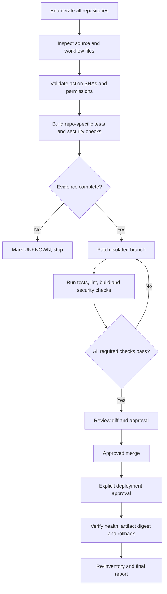
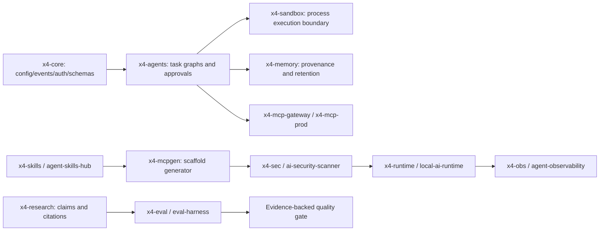

# X4 GitHub Profile Re-Audit — Evidence Dossier (Interim)

**Owner:** dhe-cruzer69  
**Snapshot:** 2026-10-23  
**Verdict:** PARTIALLY REMEDIATED — PROFILE-WIDE AUDIT, RENAMES, MERGES AND DEPLOYMENTS NOT COMPLETE.

> This report documents observed evidence only. It is not a final security certification. The listing returned 100 records and offset 100 returned zero, but it is **not proven exhaustive**: source searches and direct README lookups found additional owned repositories absent from that list, including x4-skills, x4-runtime, x4-obs, x4-sec, x4-ai-security-scanner, x4-agent-observability, x4-local-ai-runtime, x4-agent-skills-hub, x4-mcpgen, x4-mcp-server-starter, x4-memory-core, x4-eval-harness and x4-mcp-prod. The profile inventory is therefore incomplete. Source-level inspection is limited to selected repositories/workflows; the rest are explicitly UNKNOWN.

## 1. Inventory verdict

- Repositories returned: **100**; second page: **0**.
- Public: **70**; private: **30**.
- Archived: **2**; names: Repository, flow.
- Default branches: main 96, master 3, canary 1.
- Code search returned **61** matches for `uses: actions/` across **32** repositories. Search results are not guaranteed to enumerate every workflow, reusable workflow or composite action.

## 2. PR remediation and CI evidence

### x4-fleet PR #6
URL: https://github.com/dhe-cruzer69/x4-fleet/pull/6  
Latest branch commit at snapshot: `a83644ccab8fe79df0a9af6f6d5c24eec911e41d`.

Applied changes: strict RFC3339 UTC timestamp schema/runtime checks; inventory completeness and required-field validation; mutable image-tag regression tests; Draft 2020-12 schema validation; receipt validator for requested/observed digest equality and rollback-state invariants; PASS evidence vocabulary; independent registry digest re-resolution in the pipeline diagram; full-SHA pins for checkout/setup-python in the new contract workflow.

CI evidence: contract workflow run 39886246926 succeeded. General CI run 39886247032 succeeded on Python 3.11 and 3.12, including lint, type checks, unit tests and import dry-run. The PR remains draft and unmerged. This validates the queried PR merge commit, not every repository or workflow.

### arise-v9 PR #16
URL: https://github.com/dhe-cruzer69/arise-v9/pull/16  
Latest branch commit at snapshot: `e173ce23ab20d1a62532f2b35768c1968405e70d`.

Applied changes: Cloudflare Pages exact-name boundary matching; fail-fast shell handling; Compose capability/tmpfs alignment; effective Nginx configuration validation; Compose-based container smoke test and cleanup; full-SHA pins for checkout/setup-node.

CI evidence: run 39886185429 passed repository verification and Docker/Compose smoke tests. Cloudflare deploy job was skipped because the PR was not on main. No production deployment was run. The PR remains draft and unmerged.

### SHA pins verified from upstream action tags

| Action | Full SHA | Reference |
|---|---|---|
| actions/checkout | `11bd71901bbe5b1630ceea73d27597364c9af683` | v4.2.2 |
| actions/setup-python | `a26af69be951a213d495a4c3e4e4022e16d87065` | v5.6.0 |
| actions/checkout | `08c6903cd8c0fde910a37f88322edcfb5dd907a8` | v5.0.0 |
| actions/setup-node | `a0853c24544627f65ddf259abe73b1d18a591444` | v5.0.0 |

**Pinning scope:** only the two patched workflow files. Profile-wide pinning is not complete. Search results still show tag references in many repositories, including actions/checkout, setup-python, github-script, softprops/action-gh-release, gitleaks-action and CodeQL upload.

## 3. High-priority workflow findings

### F-01 — aries-ai-os
`.github/workflows/main.yml` grants `contents: write`, runs on main pushes, creates directories, runs `git add .`, commits and pushes to the default branch. This is broad automated write access without PR review. Recommend read-only verification, allowlisted generated paths, isolated branch + PR, full-SHA pins and least privilege.

### F-02 — ariex4ops Codex engineer workflow
`codex-engineer.yml` grants contents/pull-request/issues write, uses GH_ADMIN_TOKEN and OPENAI_API_KEY, checks out a repository selected by manual input and passes a free-form objective to an AI coding action. Add an exact repository allowlist, input validation, prompt-injection boundaries, least-privilege credentials and explicit approval before pushing.

### F-03 — ariex4ops fleet reconcile workflow
`fleet-reconcile.yml` can run a provisioner with GH_ADMIN_TOKEN when a boolean input and fixed phrase `ARIEX4OPS-RESET-69` match. A static phrase is not sufficient authorization for rename/delete operations. Do not run it before reviewing the provisioner, manifest, collision checks, dry-run output and per-operation approval.

### F-04 — x4-fleet nightly audit
`nightly-audit.yml` has `contents: write`, `persist-credentials: true` and pushes inventory snapshots. Review token scope, branch protection, exact writable paths and whether snapshots should instead be proposed via PR.

### F-05 — x4-fleet weekly report
`weekly-report.yml` reports zero totals if `data/inventory.json` is absent. Missing inventory must be UNKNOWN/incomplete, not a healthy zero-count report.

### F-06 — x4-sec security/release workflows
`security.yml` has a SARIF upload step with `continue-on-error: true`; this may be acceptable for reporting, but cannot be treated as a required security gate. Release/security actions remain tag-pinned in the inspected default-branch files.

### F-07 — x4-runtime release workflow
Release workflow grants `contents: write` and uses tag-pinned checkout/setup-python and `softprops/action-gh-release@v2`. Pin every action, validate source tag/commit, protect release environments and attest artifacts before calling the release process hardened.

## 4. Rename, merge and deployment status

- The 21 rename source names were looked up in the previous phase. Proposed targets `x4-skills`, `x4-runtime`, and `x4-obs` already exist. No rename occurred; a collision-free source→target manifest is required.
- Both PRs remain draft and unmerged. No merge occurred.
- No production deployment occurred. The arise-v9 deployment job was skipped on the PR branch.
- No repository was deleted, archived, made private/public, or otherwise renamed by this phase.

## 5. End-to-end governance pipeline



## 6. Profile inventory — one row per repository

| # | Repository | Visibility | Archived | Default branch | Size (KB) | Blueprint / source coverage |
|---:|---|---|---:|---|---:|---|
| 1 | dhe-cruzer69/n8n-docs | public | no | main | 905905 | Metadata only; source architecture and tests UNKNOWN |
| 2 | dhe-cruzer69/ReplitLM | public | no | main | 471 | Metadata only; source architecture and tests UNKNOWN |
| 3 | dhe-cruzer69/aries-ai-os | private | no | main | 52 | Workflow inspected; broader source audit pending |
| 4 | dhe-cruzer69/aries-ai-os1 | private | no | main | 224 | Metadata only; source architecture and tests UNKNOWN |
| 5 | dhe-cruzer69/optimus-the-ai-platform-to-bu-ui | private | no | main | 250 | Metadata only; source architecture and tests UNKNOWN |
| 6 | dhe-cruzer69/turbo-monorepo | private | no | main | 261 | Metadata only; source architecture and tests UNKNOWN |
| 7 | dhe-cruzer69/nx-monorepo | private | no | main | 306 | Metadata only; source architecture and tests UNKNOWN |
| 8 | dhe-cruzer69/next.js | public | no | canary | 2500023 | Metadata only; source architecture and tests UNKNOWN |
| 9 | dhe-cruzer69/supabase | public | no | master | 2400882 | Metadata only; source architecture and tests UNKNOWN |
| 10 | dhe-cruzer69/mobile | public | no | main | 9674 | Metadata only; source architecture and tests UNKNOWN |
| 11 | dhe-cruzer69/arise-v9 | public | no | main | 1031 | Source inspected; PR #16 remediation applied; Compose CI passed |
| 12 | dhe-cruzer69/abhiachar126-s | public | no | main | 1 | Metadata only; source architecture and tests UNKNOWN |
| 13 | dhe-cruzer69/workflow-lab | public | no | main | 9 | Metadata only; source architecture and tests UNKNOWN |
| 14 | dhe-cruzer69/markdownlint-cli-2 | public | no | main | 40069 | Metadata only; source architecture and tests UNKNOWN |
| 15 | dhe-cruzer69/auto-fix-todo-test | public | no | main | 0 | Metadata only; source architecture and tests UNKNOWN |
| 16 | dhe-cruzer69/docs | public | no | main | 2325077 | Metadata only; source architecture and tests UNKNOWN |
| 17 | dhe-cruzer69/glowing-parakeet | public | no | main | 11 | Metadata only; source architecture and tests UNKNOWN |
| 18 | dhe-cruzer69/launchdarkly-github-agent | public | no | main | 218 | Metadata only; source architecture and tests UNKNOWN |
| 19 | dhe-cruzer69/community | public | no | main | 740 | Metadata only; source architecture and tests UNKNOWN |
| 20 | dhe-cruzer69/curly-pancake | public | no | main | 0 | Metadata only; source architecture and tests UNKNOWN |
| 21 | dhe-cruzer69/provides | private | no | main | 1 | Metadata only; source architecture and tests UNKNOWN |
| 22 | dhe-cruzer69/Actions | private | no | main | 0 | Metadata only; source architecture and tests UNKNOWN |
| 23 | dhe-cruzer69/Importer | private | no | main | 0 | Metadata only; source architecture and tests UNKNOWN |
| 24 | dhe-cruzer69/Actions-2 | private | no | main | 0 | Metadata only; source architecture and tests UNKNOWN |
| 25 | dhe-cruzer69/specifically | private | no | main | 0 | Metadata only; source architecture and tests UNKNOWN |
| 26 | dhe-cruzer69/CLI | private | no | main | 0 | Metadata only; source architecture and tests UNKNOWN |
| 27 | dhe-cruzer69/Master | private | no | main | 0 | Metadata only; source architecture and tests UNKNOWN |
| 28 | dhe-cruzer69/playwright-mcp | public | no | main | 1963 | Metadata only; source architecture and tests UNKNOWN |
| 29 | dhe-cruzer69/monorepo-turborepo | private | no | main | 261 | Metadata only; source architecture and tests UNKNOWN |
| 30 | dhe-cruzer69/turborepo-v2.0 | private | no | main | 261 | Metadata only; source architecture and tests UNKNOWN |
| 31 | dhe-cruzer69/arise-genops-core | public | no | master | 141 | Metadata only; source architecture and tests UNKNOWN |
| 32 | dhe-cruzer69/Copilot | private | no | main | 0 | Metadata only; source architecture and tests UNKNOWN |
| 33 | dhe-cruzer69/Repository | private | yes | main | 0 | Metadata only; source architecture and tests UNKNOWN |
| 34 | dhe-cruzer69/github | private | no | main | 0 | Metadata only; source architecture and tests UNKNOWN |
| 35 | dhe-cruzer69/reimagined-potato | public | no | main | 954 | Metadata only; source architecture and tests UNKNOWN |
| 36 | dhe-cruzer69/astro-blog-starter-template | private | no | main | 454 | Metadata only; source architecture and tests UNKNOWN |
| 37 | dhe-cruzer69/flow | private | yes | main | 0 | Metadata only; source architecture and tests UNKNOWN |
| 38 | dhe-cruzer69/Actions9 | private | no | main | 0 | Metadata only; source architecture and tests UNKNOWN |
| 39 | dhe-cruzer69/GraphQL | private | no | main | 0 | Metadata only; source architecture and tests UNKNOWN |
| 40 | dhe-cruzer69/Actions2 | private | no | main | 0 | Metadata only; source architecture and tests UNKNOWN |
| 41 | dhe-cruzer69/Projects69 | private | no | main | 0 | Metadata only; source architecture and tests UNKNOWN |
| 42 | dhe-cruzer69/Repository69 | private | no | main | 0 | Metadata only; source architecture and tests UNKNOWN |
| 43 | dhe-cruzer69/ariex-omega | public | no | main | 11 | Metadata only; source architecture and tests UNKNOWN |
| 44 | dhe-cruzer69/MCPe | private | no | main | 0 | Metadata only; source architecture and tests UNKNOWN |
| 45 | dhe-cruzer69/MCPl | private | no | main | 0 | Metadata only; source architecture and tests UNKNOWN |
| 46 | dhe-cruzer69/Status | private | no | main | 0 | Metadata only; source architecture and tests UNKNOWN |
| 47 | dhe-cruzer69/abhia1 | private | no | main | 0 | Metadata only; source architecture and tests UNKNOWN |
| 48 | dhe-cruzer69/project-scaffold | public | no | main | 135 | Metadata only; source architecture and tests UNKNOWN |
| 49 | dhe-cruzer69/omniforge | public | no | main | 31 | Metadata only; source architecture and tests UNKNOWN |
| 50 | dhe-cruzer69/ariexus | public | no | main | 20 | Metadata only; source architecture and tests UNKNOWN |
| 51 | dhe-cruzer69/ariex4ops | private | no | main | 332 | Workflow inspected; broader source audit pending |
| 52 | dhe-cruzer69/ish | public | no | master | 5602 | Metadata only; source architecture and tests UNKNOWN |
| 53 | dhe-cruzer69/x4-claw- | private | no | main | 56 | Metadata only; source architecture and tests UNKNOWN |
| 54 | dhe-cruzer69/dhe-cruzer69 | public | no | main | 69 | Metadata only; source architecture and tests UNKNOWN |
| 55 | dhe-cruzer69/x4-core | public | no | main | 45 | Metadata only; source architecture and tests UNKNOWN |
| 56 | dhe-cruzer69/x4-agents | public | no | main | 37 | Metadata only; source architecture and tests UNKNOWN |
| 57 | dhe-cruzer69/x4-mcp | public | no | main | 8 | Metadata only; source architecture and tests UNKNOWN |
| 58 | dhe-cruzer69/x4-research | public | no | main | 13 | Metadata only; source architecture and tests UNKNOWN |
| 59 | dhe-cruzer69/x4-memory | public | no | main | 14 | Metadata only; source architecture and tests UNKNOWN |
| 60 | dhe-cruzer69/x4-mcp-gateway | public | no | main | 17 | Metadata only; source architecture and tests UNKNOWN |
| 61 | dhe-cruzer69/x4-ai | public | no | main | 14 | Metadata only; source architecture and tests UNKNOWN |
| 62 | dhe-cruzer69/x4-sandbox | public | no | main | 161 | Metadata only; source architecture and tests UNKNOWN |
| 63 | dhe-cruzer69/x4-commander | public | no | main | 2 | Metadata only; source architecture and tests UNKNOWN |
| 64 | dhe-cruzer69/x4-assist | public | no | main | 0 | Metadata only; source architecture and tests UNKNOWN |
| 65 | dhe-cruzer69/x4-router | public | no | main | 7 | Metadata only; source architecture and tests UNKNOWN |
| 66 | dhe-cruzer69/x4-code | public | no | main | 0 | Metadata only; source architecture and tests UNKNOWN |
| 67 | dhe-cruzer69/x4-docs | public | no | main | 0 | Metadata only; source architecture and tests UNKNOWN |
| 68 | dhe-cruzer69/x4-eng | public | no | main | 0 | Metadata only; source architecture and tests UNKNOWN |
| 69 | dhe-cruzer69/x4-workflow | public | no | main | 0 | Metadata only; source architecture and tests UNKNOWN |
| 70 | dhe-cruzer69/x4-vision | public | no | main | 0 | Metadata only; source architecture and tests UNKNOWN |
| 71 | dhe-cruzer69/x4-voice | public | no | main | 0 | Metadata only; source architecture and tests UNKNOWN |
| 72 | dhe-cruzer69/x4-guard | public | no | main | 0 | Metadata only; source architecture and tests UNKNOWN |
| 73 | dhe-cruzer69/x4-eval | public | no | main | 9 | Metadata only; source architecture and tests UNKNOWN |
| 74 | dhe-cruzer69/x4-repair | public | no | main | 0 | Metadata only; source architecture and tests UNKNOWN |
| 75 | dhe-cruzer69/x4-log | public | no | main | 0 | Metadata only; source architecture and tests UNKNOWN |
| 76 | dhe-cruzer69/x4-security | public | no | main | 0 | Metadata only; source architecture and tests UNKNOWN |
| 77 | dhe-cruzer69/x4-metrics | public | no | main | 0 | Metadata only; source architecture and tests UNKNOWN |
| 78 | dhe-cruzer69/x4-trace | public | no | main | 0 | Metadata only; source architecture and tests UNKNOWN |
| 79 | dhe-cruzer69/x4-cache | public | no | main | 0 | Metadata only; source architecture and tests UNKNOWN |
| 80 | dhe-cruzer69/x4-queue | public | no | main | 0 | Metadata only; source architecture and tests UNKNOWN |
| 81 | dhe-cruzer69/x4-scheduler | public | no | main | 0 | Metadata only; source architecture and tests UNKNOWN |
| 82 | dhe-cruzer69/x4-notify | public | no | main | 0 | Metadata only; source architecture and tests UNKNOWN |
| 83 | dhe-cruzer69/x4-feed | public | no | main | 0 | Metadata only; source architecture and tests UNKNOWN |
| 84 | dhe-cruzer69/x4-search | public | no | main | 3 | Metadata only; source architecture and tests UNKNOWN |
| 85 | dhe-cruzer69/x4-recommend | public | no | main | 0 | Metadata only; source architecture and tests UNKNOWN |
| 86 | dhe-cruzer69/x4-classify | public | no | main | 0 | Metadata only; source architecture and tests UNKNOWN |
| 87 | dhe-cruzer69/x4-summary | public | no | main | 2 | Metadata only; source architecture and tests UNKNOWN |
| 88 | dhe-cruzer69/x4-translate | public | no | main | 3 | Metadata only; source architecture and tests UNKNOWN |
| 89 | dhe-cruzer69/x4-codegen | public | no | main | 0 | Metadata only; source architecture and tests UNKNOWN |
| 90 | dhe-cruzer69/x4-test | public | no | main | 0 | Metadata only; source architecture and tests UNKNOWN |
| 91 | dhe-cruzer69/x4-deploy | public | no | main | 2 | Metadata only; source architecture and tests UNKNOWN |
| 92 | dhe-cruzer69/x4-infra | public | no | main | 0 | Metadata only; source architecture and tests UNKNOWN |
| 93 | dhe-cruzer69/x4-config | public | no | main | 0 | Metadata only; source architecture and tests UNKNOWN |
| 94 | dhe-cruzer69/x4-secret | public | no | main | 0 | Metadata only; source architecture and tests UNKNOWN |
| 95 | dhe-cruzer69/x4-identity | public | no | main | 0 | Metadata only; source architecture and tests UNKNOWN |
| 96 | dhe-cruzer69/x4-auth | public | no | main | 0 | Metadata only; source architecture and tests UNKNOWN |
| 97 | dhe-cruzer69/x4-role | public | no | main | 0 | Metadata only; source architecture and tests UNKNOWN |
| 98 | dhe-cruzer69/x4-audit | public | no | main | 0 | Metadata only; source architecture and tests UNKNOWN |
| 99 | dhe-cruzer69/x4-billing | public | no | main | 0 | Metadata only; source architecture and tests UNKNOWN |
| 100 | dhe-cruzer69/x4-subscription | public | no | main | 0 | Metadata only; source architecture and tests UNKNOWN |

## 7. Per-repository blueprint standard

For each repository, the final source-level dossier must include: (1) observed purpose and entrypoints from README/source, (2) architecture and Mermaid data-flow, (3) build/test/lint/type-check commands actually present, (4) dependency manifests and lockfiles, (5) every workflow and external action SHA, (6) permissions/secrets and branch protection, (7) security/dependency scanning, (8) deployment targets and rollback, (9) regression tests and results, (10) exact commit and remaining UNKNOWN items. The inventory table above does **not** substitute for these source-level checks; all entries marked metadata-only remain UNKNOWN for architecture, tests and deployment safety.

## 8. Read-only commands for continued audit

```bash
gh auth status
gh api user --jq '{login: .login, id: .id}'
gh repo list dhe-cruzer69 --limit 200 --json name,visibility,isArchived,defaultBranchRef,url
grep -RInE 'uses: [^ ]+@(v[0-9]+|main|master|latest)' .github/workflows 2>/dev/null
grep -RInE 'contents: write|pull-requests: write|issues: write|id-token: write|persist-credentials: true' .github/workflows 2>/dev/null
```

Never print secret values or run write-capable workflows solely to audit them.

## 9. Final acceptance criteria

A profile-wide PASS requires complete source/workflow enumeration, full-SHA pinning and upstream verification for every action, native tests/security scans on each final commit, reviewed least-privilege write workflows, collision-free rename mapping, individually approved merges/deployments, observed runtime health and immutable artifact identity, verified rollback evidence, and a post-change inventory comparison.

**Current verdict: INCOMPLETE / UNKNOWN.** This dossier is intentionally interim; it does not claim that all 100 repositories have been deeply audited or that the whole profile is secured.


## 10. Additional X4 ecosystem blueprints — README-derived, not production validation

The following architecture descriptions are derived from the repository READMEs inspected in this pass. They document stated design intent, not proof that all listed features are implemented, secure or tested.

### Core runtime and agent control plane

- **x4-core** — README describes shared configuration, logging, events, telemetry, authentication, permissions, plugins and schemas. Intended dependency foundation for agents, memory, sandbox and MCP. Entry example imports Config, Logger, EventBus and Permission from x4.core. Required audit: validate permission enforcement, schema evolution, logging redaction and API compatibility.
- **x4-agents** — README describes multi-agent orchestration with task graphs, policy engine, approvals, sandboxed tools, audit, memory and MCP. Required audit: prove tool execution is policy-gated, approvals cannot be bypassed, and audit records survive failures.
- **x4-sandbox** — README explicitly warns process mode is not an OS sandbox and cannot enforce network denial or hard CPU/memory/disk/filesystem quotas. This is a verified documentation limitation, not an inference. Do not run hostile code through process mode; required next step is OS-level isolation or enforce the documented trusted-code boundary.
- **ariexus** — README describes typed task graphs, a tool registry with sandboxed filesystem and allow-listed terminal, risk approvals, immutable audit logging, retry/timeout and compensation planning. Required audit: test path traversal, shell allowlists, approval bypass, retry idempotency and compensation failures.

### AI provider, memory and research components

- **x4-ai** — README describes provider-agnostic generate/stream/embed/tool/evaluate APIs across OpenAI, Anthropic, Gemini and local models. Required audit: verify provider-specific auth, retry policy, timeout bounds, prompt/data redaction and cost/latency accounting.
- **x4-runtime** — README describes local-first hardware-aware model routing, policy gate, execution receipt and fallback; cloud fallback is opt-in. Example commands: `x4-runtime detect`, `recommend --ram 8`, and `route --dry-run`. README states provider health and metering include stubs/placeholders; production inference is not established.
- **x4-local-ai-runtime** — README describes hardware detection and model-size recommendations with explicit cloud fallback. Example commands: `x4-ai detect` and `x4-ai recommend --ram 8 --gpu-vram 0`. README says production inference claims are not made until backends are wired and tested.
- **x4-memory** — README describes local-first working, episodic, semantic and knowledge-graph memory with provenance, namespace, export/deletion and privacy controls. Required audit: test deletion propagation, retention enforcement, tenant/namespace isolation and backups.
- **x4-memory-core** — README describes working, episodic and semantic layers and a storage implementation boundary. Required audit: verify persistence implementation, isolation, migration behavior and data deletion.
- **x4-research** — README describes evidence-first research with source ranking, evidence extraction, claim graphs, contradiction detection and citation validation. Required audit: verify citations are grounded in retrieved source spans and conflicting evidence cannot be silently discarded.
- **x4-eval** — README marks the project as L0 bootstrapped and explicitly says no production evaluation is claimed until evidence advances. Pipeline is runner → evaluator → reporter with lineage required.
- **x4-eval-harness** — README describes evaluation suites, dataset/run lineage validation, execution, evidence capture, scoring and baseline comparison. Required audit: test reproducibility, dataset provenance and threshold handling.

### MCP and skill supply chain

- **x4-mcp-gateway** — README pipeline: client → authentication → registry/discovery → schema validation → policy/risk decision (deny/allow/human approval) → invocation/result filter/audit. Required audit: enforce authz before tool invocation, prevent schema coercion bypass, rate-limit per identity and redact tool results.
- **x4-mcp-prod** — README describes stdio/HTTP transport, request schema validation, authentication/permissions, per-client rate limits, tool allow-lists and audit trail. Required audit: transport parity, authorization tests and denial-of-service bounds.
- **x4-skills** — README describes a verified skill registry with integrity and capability declarations; CLI includes validate, inspect, score, lock, search and verify. Required audit: verify hashes cover all executable content, lockfile trust, capability minimization and path traversal protections.
- **x4-agent-skills-hub** — README describes a skills catalog with quality, security, compatibility and maintenance scoring generated by CI. Required audit: ensure scores derive from executed checks and unknown/missing evidence never defaults to a passing score.
- **x4-mcpgen** — README describes generating MCP server scaffolds with explicit tool allow-lists, generated tool tests, SECURITY.md, license and CI. Example: `x4-mcpgen init weather --tools 2`, followed by pytest, validate and test. Required audit: test generator output for unsafe defaults and ensure generated actions are pinned.
- **x4-mcp-server-starter** — README describes scaffold generation and commands `x4-mcp init`, `x4-mcp doctor`, `x4-mcp test`, `x4-mcp security` and `x4-mcp validate`. README explicitly says scaffold does not equal production.
- **x4-sec** — README describes scanning AI-agent projects, MCP servers, skills, hooks and agent configs; CLI supports JSON and SARIF. Required audit: verify rule coverage, false negatives, severity policy and CI gate behavior. The inspected security workflow has a non-blocking SARIF upload.
- **x4-ai-security-scanner** — README describes deterministic rules-first scanning for agent repositories, skills, hooks and MCP configs, with explicit IDs and SARIF. Required audit: regression corpus, rule provenance and fail-closed exit codes.
- **x4-agent-observability** — README describes vendor-neutral local-first telemetry, console/JSONL exporters, redaction and evidence receipts, with optional OpenTelemetry compatibility. Required audit: prove redaction before export, integrity of lineage and bounded storage.

### Scaffolding, workflow and local workbench

- **project-scaffold** — README describes a Node/Express scaffold with a Python X4 runtime MVP under x4/: policy wall, task classification, provider selection, Ollama/Groq adapters, AST syntax checks, JSONL audit ledger and HTTP health/chat endpoints. Required audit: verify bind address defaults, auth on chat endpoint, SSRF controls for providers and no unsafe execution path.
- **omniforge** — README describes a local Ollama/ChromaDB/sentence-transformers workbench that plans tool sequences, reuses prior campaigns and records skills/feedback. Required audit: validate tool permissions, vector-store data isolation and untrusted content handling.
- **workflow-lab** — README describes reusable CI/security/Docker workflows, including references to reusable workflows on `@main`. This is a mutable reference and must be replaced with a reviewed commit SHA or release tag backed by a verified immutable ref before use as a security control.
- **arise-genops-core** — repository lookup succeeded but README.md returned 404 in this pass. Purpose and architecture are UNKNOWN until the default branch tree is inspected.
- **x4-fleet** — architecture and release-contract source inspection is documented in the PR #6 remediation ledger above; its release/deployment pipeline remains a design contract, not a production deploy executor.
- **arise-v9** — CI, Docker Compose and Nginx configuration were inspected and tested by CI as documented above. The Cloudflare production deployment job was skipped for the PR branch.

### README-derived architecture map



**Validation boundary:** this diagram reflects README-described intended roles. It does not establish runtime dependency wiring, complete implementation, successful tests, production readiness or security certification. Those require source, test and configuration inspection for each repository.
