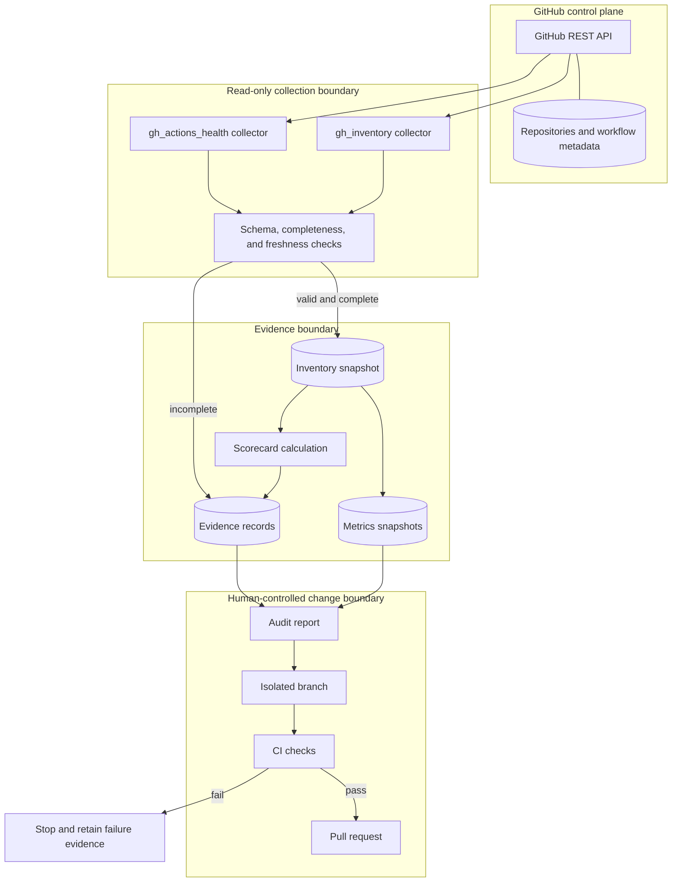

# X4 Fleet — Architecture and Data Flow

## Components and trust boundaries

## Core data contracts

### Inventory snapshot

The current collector emits a JSON object containing repository records. Consumers must treat a missing file, malformed JSON, incomplete pagination, duplicate repository IDs/names, or absent required fields as an error—not an empty fleet.

Minimum per-repository fields for scorecard inputs:

- `name`: non-empty repository name.
- `full_name`: owner/repository identity.
- `archived`: boolean.
- `private`: boolean when supplied.
- `pushed_at`: ISO timestamp or null when unknown.
- `default_branch`: non-empty branch name when supplied.

### Evidence record

The existing `data/evidence/schema.json` remains the repository evidence schema. New release-specific schemas are under `schemas/` and are intentionally separate from historical evidence entries.

## Data-flow guarantees

- Collectors are responsible for pagination and API error propagation.
- A permission error must not be converted into “zero failures” or “zero repositories.”
- Scorecards expose counts and unknowns; they do not manufacture a percentage when required inputs are missing.
- Any future mutating action must have a policy decision, explicit approval, bounded scope, and verifiable result.
