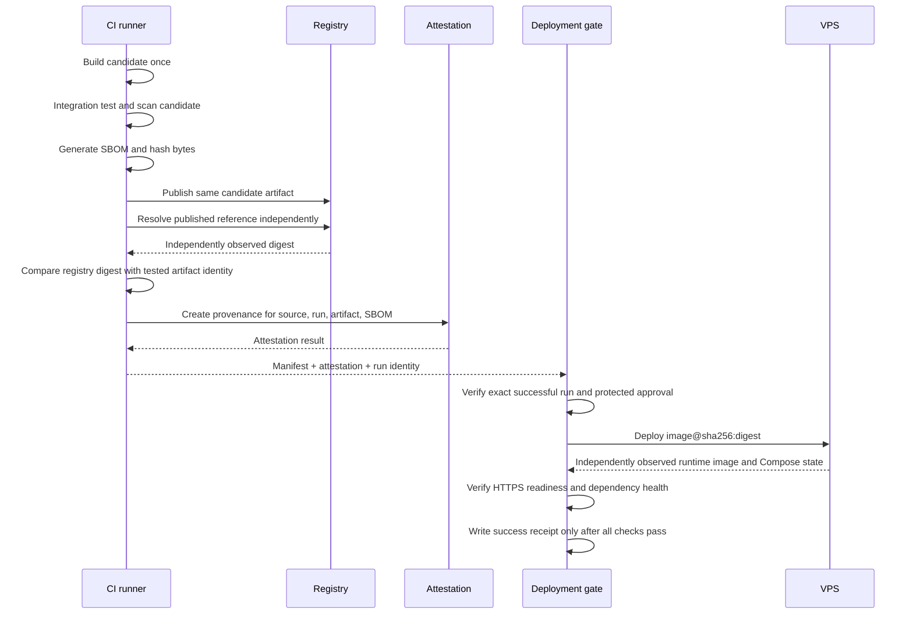

# Immutable Release and Deployment Contract

**Status: design contract only. No production release or deployment is implemented by this document.**

## Release manifest

The JSON Schema at `schemas/release-manifest.schema.json` defines the required fields. The standard-library validator at `scripts/verify_release.py` performs runtime checks without network access.

Required evidence includes:

- repository and full source commit SHA;
- exact successful workflow run ID and attempt;
- immutable image repository and SHA-256 digest;
- SBOM SHA-256 digest;
- quality, security, and integration gate results;
- UTC creation timestamp.

Gate values must be derived from completed checks. The validator can reject non-PASS values, but it cannot prove that a gate really ran. The release workflow must bind each gate to actual job results and attest the manifest.

## Pipeline

## Acceptance rules

1. No rebuild between verification and publication.
2. Registry digest must be independently resolved after publishing and match the verified artifact identity; multi-platform OCI indexes and platform manifests must not be confused.
3. SBOM must exist, parse, and have a verified digest.
4. Workflow provenance must bind repository, workflow identity, run ID, attempt, source SHA, and artifact digest.
5. Deployment uses `image@sha256:...`, never a mutable tag.
6. Running image identity must be observed from the host/runtime, not copied from the requested reference.
7. HTTPS readiness must return HTTP 200 and a structured healthy result for required dependencies.
8. A receipt reports success only after all required observations pass and requested and observed digests match.
9. Failed deployments and rollback failures produce failure receipts; never fabricate a successful rollback.

## Explicit non-goals in this PR

No Docker build/publish, registry login, SSH connection, VPS deployment, remote mutation, secret provisioning, production environment setup, or rollback executor is performed.
